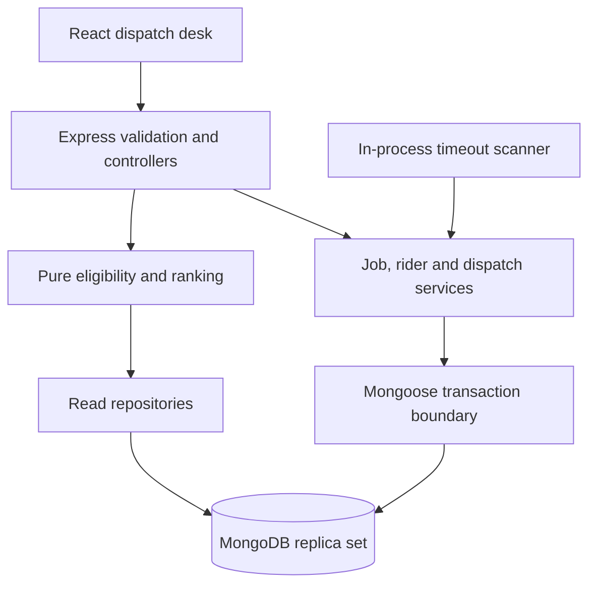
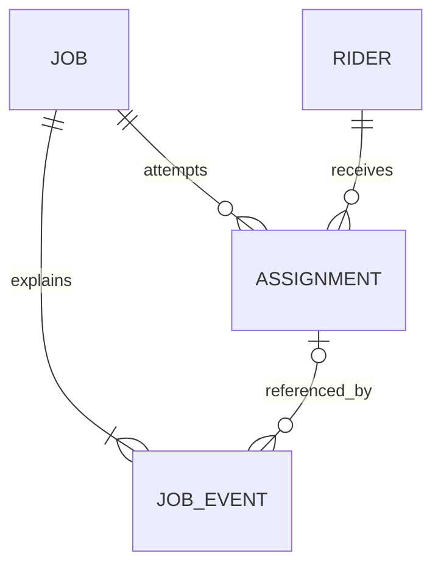

# System design proposal

Implemented through Phase 2: domain rules, four Mongoose schemas, named indexes, audit mutation guards, the transaction helper and verified replica-set startup. The dispatch services, recommendation algorithm, worker and operational UI described below remain planned. The stack follows the user's specification. The assignment itself permits tool choice. [Lifecycle](lifecycle.md), [API contract](api-contract.md) and [requirements](requirements.md) define the remaining behavior.

## Components and responsibilities

One repository with npm workspaces: `apps/api` and `apps/web`. One backend process runs Express plus a restart-safe polling worker; no queue broker is necessary. Modules own domain rules and persistence access. Controllers parse Zod input, identify actor and call a service; they do not reserve capacity or implement transitions. Pure functions rank candidates and validate lifecycle transitions; a clock abstraction allows deterministic boundary tests. Transaction callbacks use sequential awaited database operations and have no external side effects because the driver may retry them.

Use native fetch, React state and explicit refresh after mutations for this bounded dashboard. Avoid adding a global state library or client cache before there is a demonstrated need. Vite proxies `/api` and `/health` to Express locally, avoiding a CORS dependency. Frontend DTO types can be added alongside endpoints; do not expose Mongoose documents to the client.

## Data model

| Collection  | Phase 2 schema fields                                                                                                                                                                                                                                    | Purpose and constraints                                                                                                                                                                                                               |
| ----------- | -------------------------------------------------------------------------------------------------------------------------------------------------------------------------------------------------------------------------------------------------------- | ------------------------------------------------------------------------------------------------------------------------------------------------------------------------------------------------------------------------------------- |
| jobs        | `_id`, `orderReference`, `requestHash`, optional `creationKey`, pickup/delivery zone, `loadUnits`, priority, `deadlineAt?`, `status`, `activeAssignmentId?`, `assignedRiderId?`, `manualReason?`, `version`, `eventSequence`, created/updated timestamps | Reference trimmed/uppercased before hashing/indexing. Strict integer load > 0; UTC dates; server creation time. Clear current assignment/rider when releasing; history preserves old links.                                           |
| riders      | `_id`, unique `code`, `name`, `serviceZones[]`, `currentZone`, `availability`, `capacityUnits`, `reservedUnits`, `activeJobCount`, timestamps                                                                                                            | `reservedUnits` includes pending, accepted and picked-up attempts. Available capacity = total minus reserved. Availability means willing to take new work; offline does not erase existing obligations.                               |
| assignments | `_id`, `jobId`, `riderId`, `status`, `active`, `loadUnits`, `assignedAt`, `expiresAt`, `respondedAt?`, `endedAt?`, `reservationReleasedAt?`, `requestKey`, `requestHash`, recommendation snapshot/version, `overrideReason?`, actor, `endReason?`        | Attempt statuses: PENDING, ACCEPTED, PICKED_UP, DELIVERED, REJECTED, EXPIRED, CANCELLED. `active=true` until delivered/rejected/expired/cancelled. Historical attempts never removed. Store load snapshot to release original amount. |
| job_events  | `_id`, `jobId`, `sequence`, `type`, `occurredAt`, `actor`, `assignmentId?`, typed `details`                                                                                                                                                              | Separate append-only history with no edit/delete API. Sequence allocated by atomic increment on job in the event's transaction; `(jobId, sequence)` unique. Server timestamps plus sequence preserve unambiguous ordering.            |

No unbounded history arrays on jobs. Denormalized rider counters make capacity checks fast, with the cost of requiring transactions to keep them aligned. The current rider pointer on a job supports dashboard reads; the attempt remains the source for reservation amount and assignment outcome.

## Index plan and invariants

| Index                                                                               | Protection or query                                                                |
| ----------------------------------------------------------------------------------- | ---------------------------------------------------------------------------------- |
| jobs `{orderReference:1}` unique                                                    | Prevent duplicate delivery references even under parallel requests                 |
| jobs `{creationKey:1}` unique partial where string                                  | Optional Idempotency-Key replay; missing keys do not collide                       |
| jobs `{status:1,createdAt:1,_id:1}`                                                 | Stable paginated status/manual queues                                              |
| jobs `{pickupZone:1,status:1,createdAt:1}`, `{deliveryZone:1,status:1,createdAt:1}` | Filter either side of a service-zone query; inspect query plans before adding more |
| riders `{code:1}` unique; `{availability:1,serviceZones:1}`                         | Identity and eligible candidate shortlist                                          |
| assignments `{jobId:1}` unique partial `{active:true}`                              | At most one pending/accepted/picked-up attempt per job                             |
| assignments `{jobId:1,requestKey:1}` unique                                         | Durable successful assignment-command replay                                       |
| assignments `{status:1,expiresAt:1,_id:1}`                                          | Bounded due-pending scanner                                                        |
| assignments `{jobId:1,assignedAt:1,_id:1}`                                          | Full attempt history                                                               |
| events `{jobId:1,sequence:1}` unique                                                | Chronological audit and duplicate-event protection                                 |

Startup explicitly creates collections and declared indexes before listening, then exercises a snapshot-transaction read. It uses createIndexes, not syncIndexes, so operator-created indexes are preserved. Indexes are built outside transactions. Mongoose `unique` is an index declaration, not a validation rule. Handle E11000 as a replay or 409 using payload comparisons, rather than a raw 500. No TTL indexes on assignments/events: deleting an expired attempt would destroy evidence and does not implement workflow transitions.

## Consistency and concurrency design

All mutations that touch job state, rider reservation, attempt state and audit events use `withTransaction` (snapshot reads, majority writes, primary). Every query/write uses the same session. A local **single-node replica set** is required; standalone MongoDB cannot provide these transactions. Startup now verifies a writable replica set with sessions and exercises a real transaction before readiness. A single node offers local transaction semantics, not high availability.

| Risk                                | Planned protection                                                                                                                                      | Expected result                                                                                               |
| ----------------------------------- | ------------------------------------------------------------------------------------------------------------------------------------------------------- | ------------------------------------------------------------------------------------------------------------- |
| Duplicate create                    | Canonical reference + unique index; canonical request hash comparison                                                                                   | Same data returns original; changed data returns 409                                                          |
| Two dispatchers, one job            | Conditional job update from READY/MANUAL with version/current pointer check plus partial unique active attempt index                                    | One commit; other returns 409; no capacity leak                                                               |
| Two jobs, one rider                 | Atomic conditional increment requiring availability, both zones and `$expr` remaining capacity >= load                                                  | Cannot overbook; snapshot-only precheck is insufficient                                                       |
| Accept versus expire                | Conditional PENDING outcome and matching job active ID/state; accept only before expiresAt, expire at/after                                             | One outcome, one history story                                                                                |
| Duplicate release                   | Only winning guarded attempt terminalization may decrement counters in same transaction; require `reservationReleasedAt` absent and counters sufficient | Exactly one database effect; retries no-op/replay                                                             |
| Crash midway                        | Multi-document transaction includes audit                                                                                                               | All changes commit or roll back                                                                               |
| Retried command after lost response | Successful assignment key/hash persisted on attempt; responses target attempt ID                                                                        | Same attempt returned, not a new reservation                                                                  |
| Stale recommendation                | Re-evaluate eligibility/ranking within assignment transaction and record actual snapshot                                                                | Recommendation is advice, not a reservation                                                                   |
| Rider edited while assigning        | Reservation writes same rider document; capacity decrease must not violate reserved load; removing zones with active work forbidden                     | Conflicting writes retry and recheck; offline affects only future work                                        |
| Duplicate worker / restart          | Indexed persisted expiry, per-attempt conditional transaction, bounded nonoverlapping batches                                                           | At-least-once scanning with idempotent state effects                                                          |
| Rejected known-job command          | Append ASSIGNMENT_FAILED event in a separate small transaction after the rejected state transaction ends                                                | Failure visible without reserving; if audit persistence fails return 503, never report fully recorded success |

Retry only driver-labelled transient transactions; keep HTTP requests bounded and report 503 after retry exhaustion. A duplicate key must be classified against actual stored data. Unexpected/ambiguous commit outcomes need a read by command key before retrying a mutation; do not blindly decrement capacity outside the transaction. No claim of globally exactly-once execution: conditional atomic writes give one committed reservation/release effect.

## Explainable recommendation policy

Eligibility is a hard gate: available, supports **both** zones and remaining units >= job load. Capacity never becomes a soft scoring exception, including overrides. Return excluded riders with reasons for operator clarity. An override cannot bypass eligibility.

Simulate a small fixed zone-to-zone travel-time matrix. Travel estimate = rider current zone → pickup + pickup → delivery + 5 minutes per active job. Missing matrix entry uses a documented 60-minute conservative fallback and flags `estimatedByFallback`; no real GPS or SLA promise. Example weights below are design choices and must be exercised by tests before acceptance.

Lower cost ranks first: `travelCost + workloadCost + deadlineCost`.

- `travelCost = estimatedMinutes * priorityWeight` with LOW=1, NORMAL=1.5, HIGH=2, URGENT=3.
- `workloadCost = 20 * (reservedUnits / capacityUnits) + 5 * activeJobCount`.
- `deadlineCost = 4 * max(0, estimatedMinutes - minutesUntilDeadline)` when a deadline exists, otherwise 0. Past deadlines remain actionable and visibly at risk.

Return each numeric component, predicted arrival, free units, active count, explanation, scoring version and the matrix estimate. Tie break by rider code ascending. Priority increases the relative importance of travel versus load balancing; deadline penalizes likely lateness rather than removing all candidates. Rank at most the small fleet in memory for this assignment. Requesting recommendations is a POST because it records a snapshot audit event and can move no-candidate ready work into the manual queue. Repeated no-candidate checks do not repeat the manual transition event.

## Bounded operational behavior

Default confirmation deadline = assignedAt + 7,200,000 ms, captured once per attempt; changing configuration affects future attempts. Scanner interval defaults to 5,000 ms; short demo uses threshold 5,000 ms and interval 1,000 ms. Timeout is eligible at the threshold; visible movement occurs on the next successful scan, not at an exact timer instant. Scan at startup and each tick, process batches (e.g. 100), catch/report scan failures and retry. Stored deadlines allow recovery after downtime. Inject a clock into services/tests, not a public clock-changing API. Never use a setTimeout per assignment as the source of truth.

API foundation config bounds were implemented in Phase 1. The Phase 2 transaction helper uses a 15-second driver retry budget and a 5-second commit limit; callback operations must all use its session. These database timeouts are independent of the two-hour rider response threshold. Future queries should set maxTimeMS and driver server-selection/socket timeouts; these serve distinct purposes. A request timeout alone does not prove a mutation failed: command replay handles lost responses. Lists capped at 100, JSON bodies at 64 KiB. Request IDs aid troubleshooting; safe errors never expose database URLs/stacks. Actor header is only a demo identity, not an auth boundary.

## Trade-offs and references

A transaction-based modular monolith is easy to run and defend, but uses a hot rider counter document and a polling worker. Query and counter reconciliation would be needed at larger scale. Database permissions and stronger retention controls would be needed to protect audit history against privileged database users; application append-only is not tamper-proof storage.

Official references checked during Phase 1: [MongoDB transactions](https://www.mongodb.com/docs/manual/core/transactions/), [unique indexes](https://www.mongodb.com/docs/manual/core/index-unique/), [Vite prerequisites](https://vite.dev/guide/). These explain platform mechanics; the application policies above are proposed engineering decisions.

## Implemented validation boundaries

Schemas and the model factory live in `apps/api/src/modules/persistence/models.ts`; pure policies and typed Zod audit payloads live in `modules/domain`. Schema validators protect document creation/save; strict mode rejects unknown fields and immutable identity/load edits. Audit guards cover save, query/document update/delete, replacement, bulk writes and lean insertMany validation bypass. Raw collection access or a privileged administrator can bypass Mongoose guards; tests use raw deletion only for disposable fixture cleanup.

Mongoose does not enforce foreign keys, historical transitions, or cross-document counter equality. Query updates do not execute document pre-validation hooks. The future dispatch services must implement the guarded predicates and transaction boundaries in the risk table; Phase 2 verifies the infrastructure, not those unimplemented services. The temporary real-MongoDB harness verifies active-attempt indexes for pending, accepted and picked-up records and four-record rollback. Docker and production replication/permissions remain unverified.
