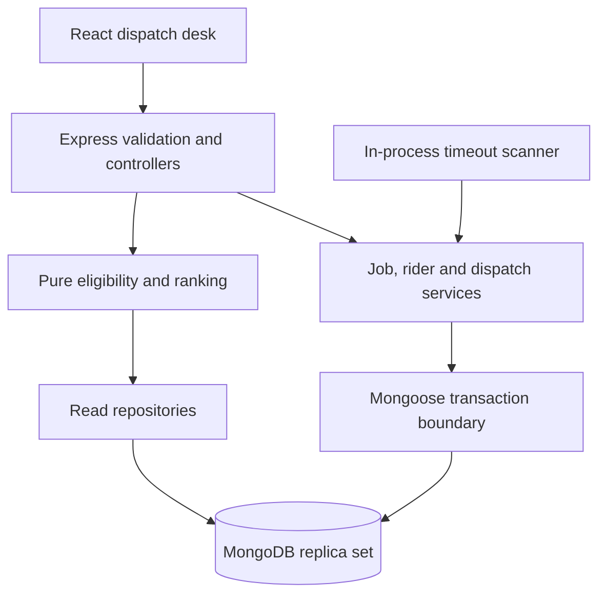
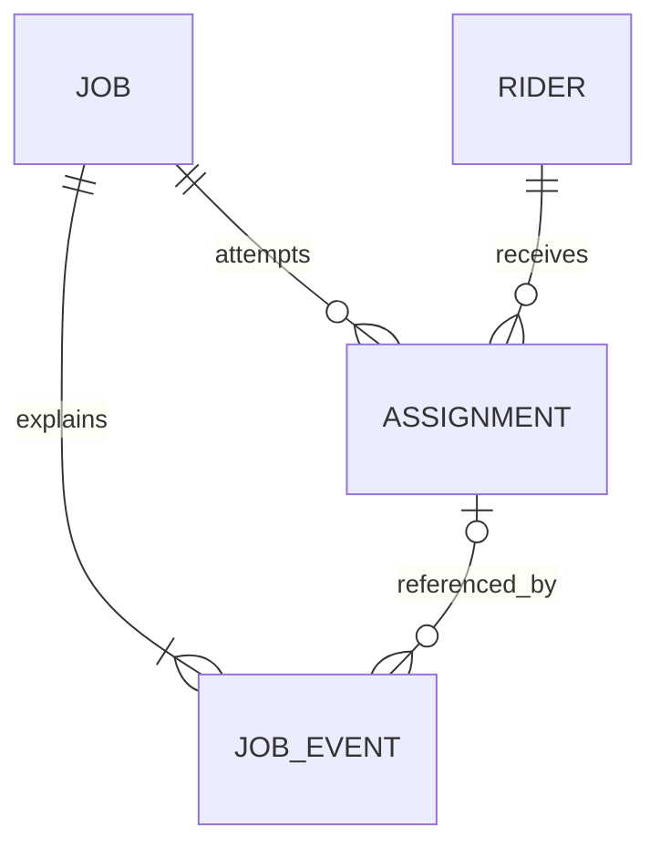

# System design proposal

Implemented through Phase 8: domain/database foundation, job/rider APIs, recommendation scoring, atomic assignment/responses/release and persisted expiry polling, plus manual queue summaries/investigation and reassignment verification. Delivery/cancellation and operational UI remain planned. [Lifecycle](lifecycle.md), [API contract](api-contract.md) and [requirements](requirements.md) track the boundary.

## Components and responsibilities

One repository with npm workspaces: `apps/api` and `apps/web`. One backend process runs Express plus a restart-safe polling worker; no queue broker is necessary. Modules own domain rules and persistence access. Controllers parse Zod input, identify actor and call a service; they do not reserve capacity or implement transitions. Pure functions rank candidates and validate lifecycle transitions; a clock abstraction allows deterministic boundary tests. Transaction callbacks use sequential awaited database operations and have no external side effects because the driver may retry them.

Use native fetch, React state and explicit refresh after mutations for this bounded dashboard. Avoid adding a global state library or client cache before there is a demonstrated need. Vite proxies `/api` and `/health` to Express locally, avoiding a CORS dependency. Frontend DTO types can be added alongside endpoints; do not expose Mongoose documents to the client.

## Data model

| Collection  | Phase 2 schema fields                                                                                                                                                                                                                                    | Purpose and constraints                                                                                                                                                                                                               |
| ----------- | -------------------------------------------------------------------------------------------------------------------------------------------------------------------------------------------------------------------------------------------------------- | ------------------------------------------------------------------------------------------------------------------------------------------------------------------------------------------------------------------------------------- |
| jobs        | `_id`, `orderReference`, `requestHash`, optional `creationKey`, pickup/delivery zone, `loadUnits`, priority, `deadlineAt?`, `status`, `activeAssignmentId?`, `assignedRiderId?`, `manualReason?`, `version`, `eventSequence`, created/updated timestamps | Reference trimmed/uppercased before hashing/indexing. Strict integer load > 0; UTC dates; server creation time. Clear current assignment/rider when releasing; history preserves old links.                                           |
| riders      | `_id`, unique `code`, `name`, `serviceZones[]`, `currentZone`, `availability`, `capacityUnits`, `reservedUnits`, `activeJobCount`, `createdBy?`, `updatedBy?`, timestamps                                                                                | `reservedUnits` includes pending, accepted and picked-up attempts. Available capacity = total minus reserved. Availability means willing to take new work; offline does not erase existing obligations.                               |
| assignments | `_id`, `jobId`, `riderId`, `status`, `active`, `loadUnits`, `assignedAt`, `expiresAt`, `respondedAt?`, `endedAt?`, `reservationReleasedAt?`, `requestKey`, `requestHash`, recommendation snapshot/version, `overrideReason?`, actor, `endReason?`        | Attempt statuses: PENDING, ACCEPTED, PICKED_UP, DELIVERED, REJECTED, EXPIRED, CANCELLED. `active=true` until delivered/rejected/expired/cancelled. Historical attempts never removed. Store load snapshot to release original amount. |
| job_events  | `_id`, `jobId`, `sequence`, `type`, `occurredAt`, `actor`, `assignmentId?`, typed `details`                                                                                                                                                              | Separate append-only history with no edit/delete API. Sequence allocated by atomic increment on job in the event's transaction; `(jobId, sequence)` unique. Server timestamps plus sequence preserve unambiguous ordering.            |

No unbounded history arrays on jobs. Denormalized rider counters make capacity checks fast, with the cost of requiring transactions to keep them aligned. The current rider pointer on a job supports dashboard reads; the attempt remains the source for reservation amount and assignment outcome.

## Index plan and invariants

| Index                                                                               | Protection or query                                                                |
| ----------------------------------------------------------------------------------- | ---------------------------------------------------------------------------------- |
| jobs `{orderReference:1}` unique                                                    | Prevent duplicate delivery references even under parallel requests                 |
| jobs `{creationKey:1}` unique partial where string                                  | Optional Idempotency-Key replay; missing keys do not collide                       |
| jobs `{status:1,createdAt:1,_id:1}`                                                 | Stable paginated status/manual queues                                              |
| jobs `{pickupZone:1,status:1,createdAt:1}`, `{deliveryZone:1,status:1,createdAt:1}` | Filter either side of a service-zone query; inspect query plans before adding more |
| riders `{code:1}` unique; `{availability:1,serviceZones:1}`                         | Identity and eligible candidate shortlist                                          |
| assignments `{jobId:1}` unique partial `{active:true}`                              | At most one pending/accepted/picked-up attempt per job                             |
| assignments `{jobId:1,requestKey:1}` unique                                         | Durable successful assignment-command replay                                       |
| assignments `{status:1,expiresAt:1,_id:1}`                                          | Bounded due-pending scanner                                                        |
| assignments `{jobId:1,assignedAt:1,_id:1}`                                          | Full attempt history                                                               |
| assignments `{riderId:1,active:1,assignedAt:1,_id:1}`                               | Rider active-workload count and ordered detail pages                               |
| events `{jobId:1,sequence:1}` unique                                                | Chronological audit and duplicate-event protection                                 |

Startup explicitly creates collections and declared indexes before listening, then exercises a snapshot-transaction read. It uses createIndexes, not syncIndexes, so operator-created indexes are preserved. Indexes are built outside transactions. Mongoose `unique` is an index declaration, not a validation rule. Handle E11000 as a replay or 409 using payload comparisons, rather than a raw 500. No TTL indexes on assignments/events: deleting an expired attempt would destroy evidence and does not implement workflow transitions.

## Consistency and concurrency design

All mutations that touch job state, rider reservation, attempt state and audit events use `withTransaction` (snapshot reads, majority writes, primary). Every query/write uses the same session. A local **single-node replica set** is required; standalone MongoDB cannot provide these transactions. Startup now verifies a writable replica set with sessions and exercises a real transaction before readiness. A single node offers local transaction semantics, not high availability.

| Risk                                | Protection / implementation status                                                                                                                      | Expected result                                                                                               |
| ----------------------------------- | ------------------------------------------------------------------------------------------------------------------------------------------------------- | ------------------------------------------------------------------------------------------------------------- |
| Duplicate create                    | Canonical reference + unique index; canonical request hash comparison                                                                                   | Same data returns original; changed data returns 409                                                          |
| Two dispatchers, one job            | Conditional job update from READY/MANUAL with version/current pointer check plus partial unique active attempt index                                    | One commit; other returns 409; no capacity leak                                                               |
| Two jobs, one rider                 | Atomic conditional increment requiring availability, both zones and `$expr` remaining capacity >= load                                                  | Cannot overbook; snapshot-only precheck is insufficient                                                       |
| Accept versus expire                | Conditional PENDING outcome and matching job active ID/state; accept only before expiresAt, expire at/after                                             | One outcome, one history story                                                                                |
| Duplicate release                   | Only winning guarded attempt terminalization may decrement counters in same transaction; require `reservationReleasedAt` absent and counters sufficient | Exactly one database effect; retries no-op/replay                                                             |
| Crash midway                        | Multi-document transaction includes audit                                                                                                               | All changes commit or roll back                                                                               |
| Retried command after lost response | Successful assignment key/hash persisted on attempt; responses target attempt ID                                                                        | Same attempt returned, not a new reservation                                                                  |
| Stale recommendation                | Re-evaluate eligibility/ranking within assignment transaction and record actual snapshot                                                                | Recommendation is advice, not a reservation                                                                   |
| Rider edited while assigning        | Reservation writes same rider document; capacity decrease must not violate reserved load; removing zones with active work forbidden                     | Conflicting writes retry and recheck; offline affects only future work                                        |
| Duplicate worker / restart          | Indexed persisted expiry, per-attempt conditional transaction, bounded nonoverlapping batches                                                           | At-least-once scanning with idempotent state effects                                                          |
| Rejected known-job command          | Append ASSIGNMENT_FAILED event in a separate small transaction after the rejected state transaction ends                                                | Failure visible without reserving; if audit persistence fails return 503, never report fully recorded success |

Retry only driver-labelled transient transactions; keep HTTP requests bounded and report 503 after retry exhaustion. A duplicate key must be classified against actual stored data. Unexpected/ambiguous commit outcomes need a read by command key before retrying a mutation; do not blindly decrement capacity outside the transaction. No claim of globally exactly-once execution: conditional atomic writes give one committed reservation/release effect.

## Explainable recommendation policy

Eligibility is a hard gate: available, supports **both** zones and remaining units >= job load. Capacity never becomes a soft scoring exception, including overrides. Return excluded riders with reasons for operator clarity. An override cannot bypass eligibility.

Simulate a small fixed zone-to-zone travel-time matrix. Travel estimate = rider current zone → pickup + pickup → delivery + 5 minutes per active job. Missing matrix entry uses a documented 60-minute conservative fallback and flags `estimatedByFallback`; no real GPS or SLA promise. The following v1 weights are implemented and tested; the complete matrix and examples are in recommendation-api.md.

Lower cost ranks first: `travelCost + workloadCost + deadlineCost`.

- `travelCost = estimatedMinutes * priorityWeight` with LOW=1, NORMAL=1.5, HIGH=2, URGENT=3.
- `workloadCost = 20 * (reservedUnits / capacityUnits) + 5 * activeJobCount`.
- `deadlineCost = 4 * max(0, estimatedMinutes - minutesUntilDeadline)` when a deadline exists, otherwise 0. Past deadlines remain actionable and visibly at risk.

Return each numeric component, estimated duration, free units, active count, explanation, scoring version and the matrix estimate. Tie break by rider code ascending. Priority increases the relative importance of travel versus load balancing; deadline penalizes likely lateness rather than removing all candidates. Rank at most the small fleet in memory for this assignment. Requesting recommendations is a POST because it records a snapshot audit event and can move no-candidate ready work into the manual queue. Repeated no-candidate checks do not repeat the manual transition event.

## Bounded operational behavior

Default confirmation deadline = assignedAt + 7,200,000 ms, captured once per attempt; changing configuration affects future attempts. Scanner interval defaults to 5,000 ms; short demo uses threshold 5,000 ms and interval 1,000 ms. Timeout is eligible at the threshold; visible movement occurs on the next successful scan, not at an exact timer instant. Scan at startup and each tick, process batches (e.g. 100), catch/report scan failures and retry. Stored deadlines allow recovery after downtime. Inject a clock into services/tests, not a public clock-changing API. Never use a setTimeout per assignment as the source of truth.

API foundation config bounds were implemented in Phase 1. The Phase 2 transaction helper uses a 15-second driver retry budget and a 5-second commit limit; callback operations must all use its session. These database timeouts are independent of the two-hour rider response threshold. Future queries should set maxTimeMS and driver server-selection/socket timeouts; these serve distinct purposes. A request timeout alone does not prove a mutation failed: command replay handles lost responses. Lists capped at 100, JSON bodies at 64 KiB. Request IDs aid troubleshooting; safe errors never expose database URLs/stacks. Actor header is only a demo identity, not an auth boundary.

## Trade-offs and references

A transaction-based modular monolith is easy to run and defend, but uses a hot rider counter document and a polling worker. Query and counter reconciliation would be needed at larger scale. Database permissions and stronger retention controls would be needed to protect audit history against privileged database users; application append-only is not tamper-proof storage.

Official references checked during Phase 1: [MongoDB transactions](https://www.mongodb.com/docs/manual/core/transactions/), [unique indexes](https://www.mongodb.com/docs/manual/core/index-unique/), [Vite prerequisites](https://vite.dev/guide/). These explain platform mechanics; the application policies above are proposed engineering decisions.

## Implemented validation boundaries

Schemas and the model factory live in `apps/api/src/modules/persistence/models.ts`; pure policies and typed Zod audit payloads live in `modules/domain`. Schema validators protect document creation/save; strict mode rejects unknown fields and immutable identity/load edits. Audit guards cover save, query/document update/delete, replacement, bulk writes and lean insertMany validation bypass. Raw collection access or a privileged administrator can bypass Mongoose guards; tests use raw deletion only for disposable fixture cleanup.

Mongoose does not enforce foreign keys, historical transitions, or cross-document counter equality. Query updates do not execute document pre-validation hooks. The future dispatch services must implement the guarded predicates and transaction boundaries in the risk table; Phase 2 verifies the infrastructure, not those unimplemented services. The temporary real-MongoDB harness verifies active-attempt indexes for pending, accepted and picked-up records and four-record rollback. Docker and production replication/permissions remain unverified.

## Phase 3 job implementation

`modules/jobs/contracts.ts` validates and canonicalizes requests; `router.ts` handles HTTP parsing/status; `service.ts` owns transactions, queries, replay and guarded transitions; `dto.ts` explicitly excludes private hashes/keys. `modules/history/append-event.ts` requires an active session, increments the job event counter and inserts the typed event in the same transaction. It does not increment the state version; the ready state mutation increments that separately. Failed audit storage rolls both back.

Creation checks a durable key first, then the normalized reference; conflicting key ownership takes precedence. The canonical hash makes explicit defaults/ISO offsets equivalent. A different key on an existing reference is rejected, avoiding unbound key reuse without adding another collection. Duplicate-key recovery runs after the aborted transaction, using only job identity indexes; audit-index conflicts are not swallowed. Unknown creation commit results are reconciled by a majority read; unresolved outcomes return 503 and callers retry the same request. Ready retries rely on the stored current state. Read-only lists/history use sequential snapshot queries for consistent pagination totals within each response and have bounded page sizes/query timeouts. This adds transaction overhead to reads, an acceptable small-application trade-off.

See job-api.md and phase-3-report.md for the tested scope. These job concurrency checks do not prove assignment reservation or release-once behavior, which remains a later feature.

## Phase 4 rider implementation

`modules/riders` owns strict create/PATCH/list contracts, safe DTOs, thin routes and transaction-owning services. `http/contracts.ts` supplies shared actor/ObjectId/zone/pagination rules; job contracts re-export compatible names. Event/attempt read DTOs now live in history/dto.ts and are reused by job history and rider workload.

Creation captures a unique normalized immutable code, zero counters and server-owned actor/time provenance. Lists filter exact code, supported service zone and availability. Detail pages include bounded active attempts under a new rider/active/assignedAt index; counters and rows are read in one snapshot. Pending, accepted and picked-up attempts remain occupied.

PATCH validates current counters, then proposed capacity and zone changes. Reducing capacity below reserved units conflicts. Any coverage removal conflicts while active work remains (an intentionally conservative policy); additions are safe. Offline configuration preserves reservations. A conditional update writes only supplied configuration fields plus updatedBy/time and guards the counter/capacity snapshot. A concurrent write to the rider causes a transaction conflict and a fresh recheck; controlled real-MongoDB tests prove the stale-read capacity/zone cases and preservation during offline changes. Future reservation services must still guard availability, coverage and capacity atomically; these tests do not implement that service.

CreatedBy/updatedBy are last-writer provenance, not a full rider audit log. Job events retain their append-only semantics and are not fabricated for unrelated rider configuration. The four-collection design is preserved.

## Phase 5 recommendation implementation

`modules/recommendations/engine.ts` is pure: explicit job/rider inputs, clock value and optional travel matrix; no database/HTTP access. It returns the existing strict v1 snapshot shape with numeric breakdowns, reasons and deterministic ranks. Invalid local counters exclude that rider explicitly. Both zones and remaining capacity are hard gates. Binary code/ID tie breaks avoid host-locale differences; rounded components explain the rounded total. See recommendation-api.md for the exact matrix and formula.

The service reads the job/fleet in one snapshot and appends RIDERS_RECOMMENDED. With zero candidates, READY becomes MANUAL with NO_ELIGIBLE_RIDER and a second event, in the same transaction. Already-manual reevaluation keeps the original reason/state version. A fresh evaluation is audited per request, without command-key replay; uncertain commits return 503 and retries can add evaluation events. History retains the original snapshot.

Audit sequence allocation writes the job document, forcing retries against concurrent job writes. Tests demonstrate eight concurrent no-candidate evaluations produce one manual entry, plus a deterministic stale-read cancellation fixture rejects a now-invalid evaluation. Riders are read without reservations; concurrent rider changes may make advice stale. Phase 6 must recompute eligibility and guard capacity on the rider document. The full fleet and snapshots are unbounded in rider count, a documented small-fleet trade-off. No new indexes, collections or dependencies were needed.

## Phase 6 assignment implementation

`modules/dispatch/contracts.ts` validates/canonicalizes the command and hashes only rider ID/reason. `router.ts` handles HTTP; `service.ts` owns the transaction/recovery/failure-audit boundaries and reuses the pure ranking engine. Existing collections/indexes suffice. Server wiring now passes the validated response threshold into assignment creation; no worker runs yet.

The service reads job and successful key first. Exact replay returns original attempt/current job without revalidating eligibility or adding events; a changed payload conflicts. New commands require READY/MANUAL with no active attempt. The transaction computes scoring, validates choice/override, conditionally updates job status/version/empty pointers, and increments rider counters with availability, both zones, capacity/counter snapshots and a remaining-capacity expression. This rider write forces competing jobs/configuration edits to retry against fresh state. Query `$inc` is protected by explicit invariants, not assumed document-hook validation. It inserts an immutable attempt/load/expiry/receipt/snapshot and required events before commit.

Snapshots represent a consistent fleet view, not global serialization of all rider rankings: other unselected riders can change. Hard eligibility/capacity of the selected rider is guarded by its write. Partial active-attempt and job/key unique indexes remain defense in depth. Terminal fixtures verify receipt lifetime/reassignment primitives; the real response/release flow is still Phase 7/8.

Recognized assignment-index/unknown-commit results are resolved from a receipt in a fresh transaction; unresolved outcomes return 503. Auditable known-job business failures append ASSIGNMENT_FAILED only after state rollback, in a separate transaction; failed audit confirmation returns 503. No false failed reservation attempt is fabricated. Tests verify eight-way same-job/same-key races, six jobs sharing limited capacity, both orders of actual public rider configuration conflicts, rollback, private DTOs and receipt recovery. See assignment-api.md and phase-6-report.md.

## Phase 7 resolution and worker implementation

`dispatch/resolution.ts` owns the shared accept/reject/expire transaction. It verifies the attempt/job relationship, replay/outcome and exact current pointers, captures a fresh decision time, conditionally writes job and PENDING/active/unreleased attempt, releases original capacity when terminal, and appends outcome/manual events. `release-reservation.ts` checks local current/resulting counters and guards the decrement within that same transaction. Only the winning terminalization may release. Acceptance retains capacity. The late-response 409 is emitted after expiry commits, not thrown inside its callback.

`worker/timeout-scanner.ts` shortlists at most 100 due PENDING attempts under the existing expiry index, resolves each sequentially, continues individual failures and checks shutdown between attempts. `timeout-worker.ts` scans on startup and uses a new timer only after completion, preventing local overlap. Persisted expiries support restart recovery; duplicate processes are guarded in MongoDB. Polling controls latency, not exact wall-clock execution. Startup starts the worker after listen success; shutdown drains HTTP/current scan before database close under the existing 10-second process budget.

Tests verify forced simultaneous pre-write snapshots for acceptance/expiry with either winner, fresh decision time on real transaction retry, equality expiry, opposing responses, repeated outcomes, duplicate scanners, bounded ordered scans, failure retry and actual reassignment without old-ID interference. Fake timers test scheduler timing; real MongoDB tests cover business outcomes. No production failover or exact-time scheduler guarantee is claimed. See response-timeout-api.md for limits and policy details.

## Phase 8 manual queue read model

`modules/manual-queue` owns bounded zone/page contracts, a thin GET route and a snapshot-owning read service. It filters MANUAL jobs, orders createdAt/ID for oldest received first, then batches relevant event/attempt aggregation by the page IDs. Projections remove scoring snapshots before grouping, so queue payloads stay compact and there is no query per row. Existing indexes suffice; very large job histories can still make aggregation expensive, bounded by query/transaction timeouts.

Current manual age comes from the latest MANUAL_QUEUE_ENTERED sequence, not mutable job updatedAt. Missing/reason-mismatched evidence is flagged with null age/time/entry actor, without hiding or repairing the job. Latest attempt summaries order assignedAt/ID; latest failed-command evidence uses event sequence. Full history/snapshots remain available through the existing endpoint. Shared attempt summary DTO extraction preserves existing full attempt responses.

No separate queue collection or reassignment mutation is introduced. The assignment/resolution services already own membership transitions, eligibility, original-load release and attempt retention. Tests add real public investigation/reassignment, override correction, eight concurrent dispatchers and a gated count-versus-reassignment read race: the returned count, row and previous attempt remain on one snapshot, while the next request sees removal. See manual-queue-api.md and phase-8-report.md.
