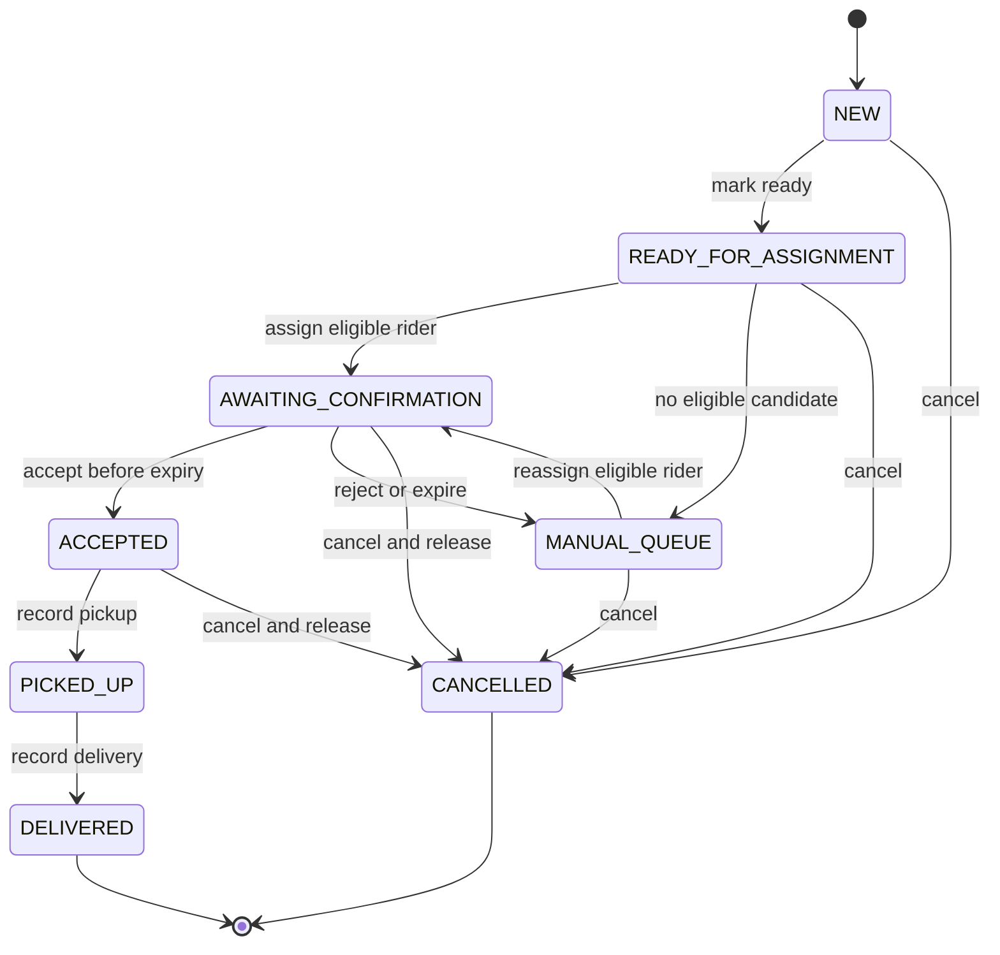

# Job and assignment lifecycle

All transitions below are implemented and verified through guarded service commands. Ready replay is handled before the pure transition table and never resets later states. Explicit endpoints prevent unrestricted status edits. Matching cancellation retries require the same trimmed reason; changed reasons conflict.

| Command and allowed job source                 | Attempt change                                                        | Capacity effect                                 | Required audit                                                                 |
| ---------------------------------------------- | --------------------------------------------------------------------- | ----------------------------------------------- | ------------------------------------------------------------------------------ |
| Create                                         | None                                                                  | None                                            | JOB_CREATED, actor and submitted fields                                        |
| Mark ready: NEW                                | None                                                                  | None                                            | JOB_READY                                                                      |
| Recommend: READY or MANUAL                     | Snapshot only; if none, set manual reason NO_ELIGIBLE_RIDER           | None                                            | RIDERS_RECOMMENDED; MANUAL_QUEUE_ENTERED only on actual entry                  |
| Assign/reassign: READY or MANUAL               | New PENDING, active true; store expiry, score and optional override   | Increment reservedUnits/load and activeJobCount | ASSIGNMENT_CREATED; REASSIGNED if prior attempt; MANUAL_OVERRIDE if applicable |
| Accept: AWAITING, matching active attempt      | PENDING → ACCEPTED, before expiry                                     | Keep reservation                                | ASSIGNMENT_ACCEPTED; job ACCEPTED                                              |
| Reject: AWAITING, matching active attempt      | PENDING → REJECTED, active false, release marker                      | Decrement exactly once                          | ASSIGNMENT_REJECTED; MANUAL_QUEUE_ENTERED, reason RIDER_REJECTED               |
| Expire: AWAITING, matching active attempt      | PENDING → EXPIRED, active false, release marker                       | Decrement exactly once                          | ASSIGNMENT_EXPIRED; MANUAL_QUEUE_ENTERED, reason RESPONSE_TIMEOUT              |
| Pickup: ACCEPTED                               | ACCEPTED → PICKED_UP                                                  | Keep reservation                                | JOB_PICKED_UP                                                                  |
| Deliver: PICKED_UP                             | PICKED_UP → DELIVERED, active false, release marker                   | Decrement exactly once                          | JOB_DELIVERED                                                                  |
| Cancel: NEW, READY, MANUAL, AWAITING, ACCEPTED | Active pending/accepted attempt → CANCELLED, inactive, release marker | Release if reserved; otherwise no change        | JOB_CANCELLED, actor/reason and attempt outcome if present                     |

Every listed mutation and its events commit together. MANUAL has no active attempt or assigned rider; the prior attempt remains queryable. DELIVERED/CANCELLED are terminal. Cancellation after pickup is rejected (409); real post-pickup failure/return workflows are outside this exercise. A dispatcher cannot overwrite a pending attempt directly: reject/cancel must finish its reservation first. Reassignment is a new attempt from MANUAL, not a rewrite of an old one.

## Expiry boundary and response retries

At each transaction attempt, capture a fresh server decision time immediately before guarded state writes. Acceptance requires `expiresAt > decisionTime`; timeout requires `expiresAt <= decisionTime`. Equality expires. Both commands guard PENDING plus job pointer/status; transaction conflicts resolve a concurrent race. This uses server decision time, not a promise that commit occurs before the wall-clock deadline. A decision begun before expiry may commit just after expiry. Tests must state this policy explicitly.

If accept/reject arrives after expiry but before the worker, the service first performs the same guarded expiration operation and returns 409 ASSIGNMENT_EXPIRED. Rejection before expiry moves immediately to manual. Replays of the exact previously committed accept/reject action return 200 without new events; opposing decisions return 409. Old assignment IDs cannot act on new attempts. Pickup/delivery repeat of the exact current terminalized command can replay without a second release; other backward transitions return 409. Cancellation replay returns current cancelled job without appending a second event.

## Reservation invariant

For every rider: `reservedUnits = sum(loadUnits for active attempts)` and `activeJobCount = count(active attempts)`. Pending, accepted and picked-up attempts all occupy capacity. Counter decrements require the stored attempt load, an unset release marker and sufficient counters; an invariant failure aborts and reports an operational error rather than silently clamping to zero. No release on confirmation or pickup. The worker only handles pending attempts, never accepted or picked-up ones.

## Audit events

Events are inserts only and receive per-job sequence numbers in the same transaction. Store user actor (demo `X-Actor-Id`), `system:timeout-worker` for automatic expiry, event type, timestamp, job/attempt IDs and meaningful before/after details. Recommendation/override events store scoring version, ranked candidates and chosen reason; store the snapshot rather than recomputing past explanations using current rider data. Known-job eligibility/assignment conflicts append ASSIGNMENT_FAILED separately after rollback with actor/reason; malformed requests and missing jobs return errors without inventing a job history. Operational history endpoint returns events plus attempts, making every rejected/expired attempt visible after success.

## Phase 5 recommendation behavior

The recommendation command is legal only for READY_FOR_ASSIGNMENT and MANUAL_QUEUE. It records a v1 snapshot without reserving capacity. Zero eligible riders changes READY to MANUAL with NO_ELIGIBLE_RIDER, increments state version and appends a manual-entry event in the same transaction as the recommendation event. Already-manual reevaluation preserves reason/version, even when a new candidate is found; dispatcher assignment remains explicit.

Each evaluation is audited; request retries may create another snapshot. Audit insertion failure rolls back the state and every event. Per-job sequence writes serialize conflicting job changes, while rider reads remain advice without a reservation. See recommendation-api.md for the tested scoring and concurrency policies.

## Phase 6 assignment behavior

READY/MANUAL assignment now transitions to AWAITING_CONFIRMATION with a new PENDING attempt and both active pointers. It clears manualReason, increments version once and reserves the original job load plus one active-job slot. Successful audit includes a fresh recommendation snapshot, assignment event, optional reassignment link and optional override reason. All effects commit or roll back together.

Replay checks receipt identity before lifecycle legality; it returns the original attempt/current job without another increment. Other commands against active/terminal jobs conflict and remain visible through failure events. expiresAt is captured from configuration; the response/expiry services below execute the guarded outcomes.

## Phase 7 response and expiry implementation

The accept/reject/expire rules above are now implemented in dispatch/resolution.ts with guarded transactions and explicit post-commit late-response errors. Accepted work retains reservation. Rejection/expiry terminalizes once, validates/decrements original load and clears job pointers while entering manual. Same rejected reason or matching accepted outcome replays; expired response IDs conflict without another release. Real reassignment tests prove old IDs cannot change new work.

The scanner handles persisted due PENDING attempts only. It runs at startup, limits/serializes each batch, retries failures and schedules after completion. Deadline equality and both race outcomes are tested; driver retry captures a fresh time. Pickup/delivery/cancellation are implemented in delivery/service.ts with the same transaction and release predicates.

## Phase 8 queue investigation

The dedicated queue now reads MANUAL state with its latest entry event and retained attempt/command evidence. It does not mutate lifecycle or create history on GET. Waiting time resets only when a new manual entry commits; reevaluation/failure does not reset it. Reassignment remains a new assignment from MANUAL using a fresh command key and existing guards. Concurrent stale queue reads cannot authorize another reservation. Full history continues to retain earlier attempts and their score snapshots.
